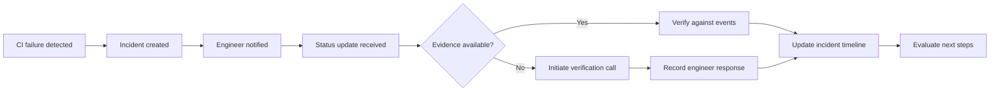
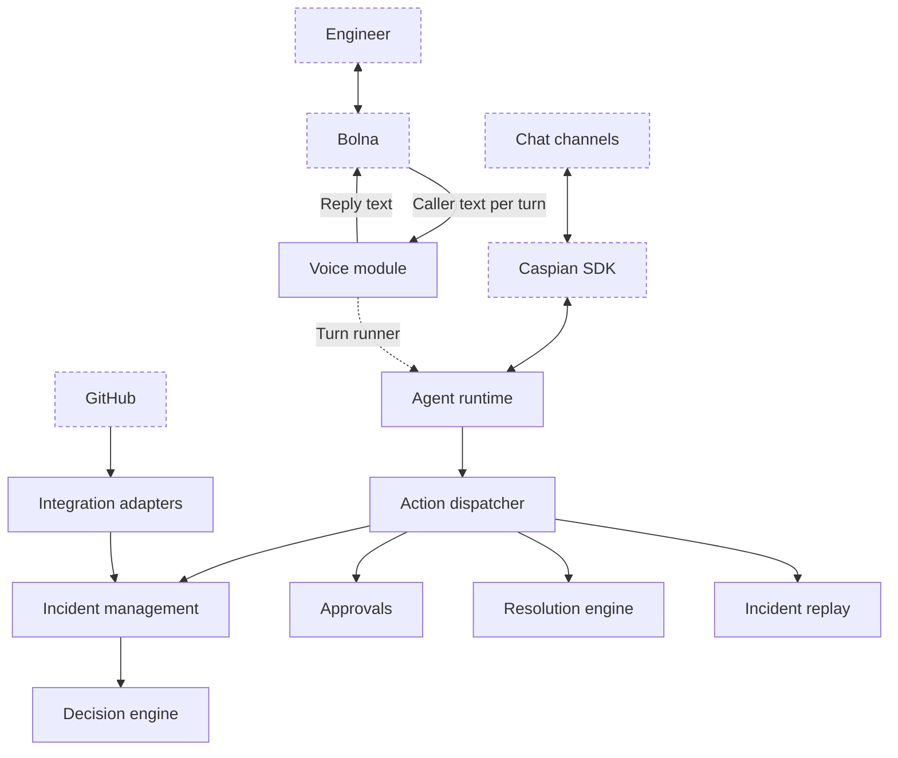

<h1 align="center">Svaar</h1>

<p align="center">
  <strong>An AI incident response agent that verifies updates, coordinates engineers, and picks up the phone.</strong>
</p>

<p align="center">
  <a href="https://svaar.vercel.app/">Website</a> ·
  <a href="https://svaar-demo.onrender.com/health">Live API</a> ·
  <strong>Status:</strong> core workflows built and tested, API live on Render; calls answered by Svaar and end-to-end chat delivery are next
</p>

<!-- Demo video: add the link to the line above once it is recorded. -->

<p align="center">
  <a href="#overview">Overview</a> ·
  <a href="#capabilities">Capabilities</a> ·
  <a href="#how-it-works">How It Works</a> ·
  <a href="#architecture">Architecture</a> ·
  <a href="#getting-started">Getting Started</a>
</p>

---

## Overview

**Incident response is only as reliable as the information behind it.**

When production systems fail, engineering teams are flooded with status updates, messages and assumptions. Someone says the build passed. Someone else says the fix was merged. An engineer believes the service is back online.

But who verifies it?

Traditional incident management relies heavily on manual updates, fragmented communication and engineers remembering to follow up. This creates information gaps, delays decisions and makes accountability difficult precisely when teams need it most.

**Svaar changes that.**

Svaar is an AI-powered incident response agent that connects engineering communication with operational evidence. It monitors CI pipelines, tracks incidents, verifies status claims against actual system events and contacts engineers through voice conversations when information is missing.

Instead of simply collecting updates, Svaar checks whether they are true.

It gives engineering teams a more reliable picture of what is happening, who is responsible and what needs attention next.

## The problem we're solving

Modern engineering teams already have monitoring systems, CI pipelines, issue trackers and communication platforms.

Yet these systems rarely provide a unified, verified account of an ongoing incident.

- **Fragmented information:** Incident context is scattered across chat, CI logs and issue trackers.
- **Unverified updates:** Progress reports are often accepted without checking the underlying evidence.
- **Delayed communication:** Engineers miss notifications, acknowledgement deadlines and handoffs.
- **Manual coordination:** Incident leads spend valuable time chasing updates instead of resolving failures.
- **Unclear accountability:** Teams struggle to distinguish confirmed progress from assumptions.

Svaar brings these pieces together through an agent that can observe, communicate, verify and coordinate.

## Capabilities

### 1. Automated incident detection

Svaar monitors GitHub Actions workflows and identifies failed CI runs.

Related failures are grouped into incidents, assigned clear ownership and communicated privately to the responsible engineer.

The objective is to reduce duplicate notifications and give teams a single place to understand an ongoing failure.

### 2. Evidence-backed status verification

Svaar checks engineering updates against actual operational events.

When an engineer reports that a build passed, a fix was merged or a workflow completed, Svaar checks the claim against authenticated GitHub events.

Claims are confirmed only when supporting evidence exists.

Missing information is treated as unknown, not as proof of failure.

### 3. Voice-based incident communication

When an update cannot be verified automatically, Svaar can initiate a bounded voice mission through Bolna.

It contacts the relevant engineer, asks a focused question and records the response for the incident workflow.

This provides an additional communication channel without requiring incident leads to manually chase every update.

### 4. Intelligent escalation

Svaar tracks acknowledgement deadlines and prepares escalation when an owner does not respond.

Cooldowns, recipient limits and bounded background processing help prevent notification spam.

### 5. Constraint-aware resolution planning

Incidents frequently introduce competing operational constraints.

Release windows, available engineers, system capacity and deadlines can all influence the next decision.

Svaar evaluates these constraints, proposes a resolution plan and validates the proposal against deterministic rules before any operational change is considered.

### 6. Auditable incident history

Svaar maintains structured records of observations, claims, evidence, decisions and actions.

Incident simulations are isolated from live operational records, allowing teams to explore possible outcomes without contaminating actual incident history.

## How it works



The workflow follows five stages:

1. **Observe:** Svaar detects operational events and incoming updates.
2. **Organize:** Related failures are grouped into incidents with clear ownership.
3. **Verify:** Claims are checked against trusted external evidence.
4. **Communicate:** Missing information triggers a focused voice interaction when appropriate.
5. **Coordinate:** Decisions and resolution proposals are recorded and evaluated.

The result is a more complete and trustworthy incident picture.

## Architecture

Svaar is designed as a modular monolith built with FastAPI and PostgreSQL.

The architecture separates communication, decision-making, business actions and external integrations while maintaining a centralized execution boundary.



Dashed components represent external systems.

### System modules

| Module | Responsibility |
| --- | --- |
| `agent` | Conversation runtime, LLM integration, memory, tool orchestration and messaging |
| `identity` | Organizations, principals, roles, invitations and verified identities |
| `actions` | Centralized tool registry, authorization, validation and execution |
| `incidents` | Incident records, event timelines, claims and supporting evidence |
| `decisions` | Typed decisions, confidence policies and deterministic fallbacks |
| `voice` | Bolna integration, voice authentication and bounded call missions |
| `resolution` | Constraint evaluation, negotiation and resolution proposals |
| `approvals` | Confirmation workflows for sensitive operations |
| `integrations` | GitHub App, webhooks and external service adapters |
| `replay` | Isolated incident simulation |
| `jobs` | Background processing, acknowledgement deadlines and escalation |
| `api` | API composition, health checks and infrastructure interfaces |

### Architectural principles

**Centralized action execution**

Every business tool call passes through the same dispatcher. Authorization, argument validation, risk classification and confirmation requirements are enforced independently of the communication channel or language model.

**Separation of concerns**

The agent and voice modules communicate through an explicit protocol rather than importing each other. External provider SDKs and HTTP contracts remain behind adapters.

**Durable processing**

PostgreSQL stores conversations, inbound messages, outbound messages, incident records and processing cursors. Deduplication and controlled retries help prevent repeated side effects.

**Simulation isolation**

Replay operations use separate records and never enter the live incident event stream.

## Security and reliability

Svaar is built around a fundamental principle:

<p align="center">
  <strong>Models propose. Deterministic code enforces.</strong>
</p>

AI can interpret conversations, formulate responses and suggest actions. It cannot independently authorize or execute sensitive operations.

Key safeguards include:

- **Centralized authorization:** Every business action passes through the same execution layer.
- **Verified identity:** Team members join through single-use invitations and role-based authorization.
- **Protected operations:** Sensitive actions require a one-time confirmation code delivered through a separate verified channel.
- **Restricted voice missions:** Calls operate with predefined tool permissions and cannot expand their own scope.
- **Evidence-based decisions:** Missing evidence, unanswered calls and failed calls never automatically invalidate an engineering claim.
- **Idempotent processing:** Duplicate messages, webhooks and voice turns are controlled through durable identifiers.
- **Privacy-conscious logging:** Transcripts, phone numbers, message contents and credentials are excluded from application logs.
- **Bounded execution:** Model inference and external operations operate within explicit deadlines and resource limits.

These controls are implemented and covered by automated tests. Live provider acceptance is tracked separately.

## Technology stack

| Component | Technology |
| --- | --- |
| Backend | Python, FastAPI |
| Database | PostgreSQL |
| ORM | SQLAlchemy |
| Database migrations | Alembic |
| AI runtime | OpenAI-compatible LLMs |
| Agent orchestration | Native tool calling |
| Voice infrastructure | Bolna |
| Communication gateway | Caspian SDK |
| CI integration | GitHub Actions |
| HTTP clients | httpx |
| Containerization | Docker, Docker Compose |
| Testing | pytest |
| Formatting and linting | Ruff |
| Dependency management | uv |

## Getting started

### Prerequisites

- Python 3.11+
- Docker and Docker Compose
- uv 0.11.29

### Installation

Clone the repository and install dependencies:

```bash
git clone https://github.com/shreya-mishra325/svaar.git
cd svaar

python -m pip install uv==0.11.29
uv sync --locked
```

Create a local environment file:

```bash
cp .env.example .env
```

For Windows PowerShell:

```powershell
Copy-Item .env.example .env
```

Configure the required environment variables in `.env`.

Start PostgreSQL:

```bash
docker compose up -d --wait db
```

Apply database migrations:

```bash
uv run --locked alembic upgrade head
```

Start the API:

```bash
uv run --locked uvicorn svaar.app:create_app --factory --reload --no-access-log --no-proxy-headers
```

The API will be available at:

| Endpoint | Purpose |
| --- | --- |
| `/health` | Application liveness |
| `/ready` | Database connectivity |
| `/docs` | Interactive API documentation |

### Docker deployment

To build and run the application using Docker Compose:

```bash
docker compose up --build --wait app
```

View application logs:

```bash
docker compose logs app
```

Stop the application:

```bash
docker compose down
```

For hardened demo deployment and environment-specific configuration, refer to the deployment documentation.

## Testing and development

Svaar includes automated tests covering its core workflows, infrastructure boundaries and security requirements.

Run formatting:

```bash
uv run --locked ruff format .
```

Run linting:

```bash
uv run --locked ruff check .
```

Run the test suite:

```bash
uv run --locked pytest
```

PostgreSQL integration tests require a separate disposable test database configured through `SVAAR_TEST_DATABASE_URL`.

The test suite covers:

- Incident and claim lifecycle management.
- Authorization and role enforcement.
- Confirmation and approval workflows.
- Duplicate message and webhook handling.
- Voice authentication and mission restrictions.
- Agent execution and tool boundaries.
- Database transactions and durable processing.
- Provider adapter behavior through mocked integrations.

## Integrations

Svaar is designed to work with existing engineering infrastructure rather than replace it.

| Integration | Purpose |
| --- | --- |
| GitHub Actions | CI monitoring and workflow events |
| GitHub App | Authenticated repository integration |
| Caspian | Chat communication gateway |
| Bolna | Voice conversations and call orchestration |
| OpenAI-compatible APIs | Language models and tool calling |
| PostgreSQL | Persistent application and incident state |

The integration layer is adapter-based, allowing provider implementations to evolve independently of the core incident management logic.

## Current implementation status

Svaar's core architecture, incident workflows, action authorization, agent runtime and provider adapters have been implemented.

The current public demo deployment has passed Render API and database infrastructure checks.

| Area | Implementation status |
| --- | --- |
| Core API and database | Implemented and checked |
| Incident management | Implemented |
| GitHub integration | Implemented |
| Evidence verification | Implemented |
| Agent runtime and tool execution | Implemented and tested |
| Authorization and approvals | Implemented and tested |
| Voice orchestration | Implemented |
| Bolna provider integration | Implemented; outbound call completed live, Svaar-answered call next |
| Caspian Telegram adapter | Read-only provider checks passed |
| Chat enrollment and delivery | End-to-end acceptance pending |
| Resolution planning | Implemented |
| Incident replay | Implemented |
| Render infrastructure | Public API/database checks passed |

### Verified live

- **Render:** the public API is up, and its API and database checks passed.
- **Bolna:** the account and agent are ready, and a real outbound call placed through Svaar's adapter was answered and completed. The agent on that call ran on Bolna's own model, not Svaar's.
- **Caspian:** authenticated connection and polling checks passed for Telegram.
- **Groq:** native tool calling passed on the selected model.

### Next

- A real call answered by Svaar through the voice turn route.
- Chat enrollment and message delivery, end to end.
- A real GitHub failure flowing through to an owner alert and timeline.

Automated tests cover the implemented behavior; anything not listed under Verified live has not been accepted against a live provider yet.

## Documentation

For implementation and operational details:

- [Deployment Guide](docs/DEPLOYMENT.md)
- [Render Deployment](docs/RENDER_DEPLOYMENT.md)
- [Channel Acceptance](docs/CASPIAN_CHANNELS.md)
- [Implementation History](docs/IMPLEMENTATION_HISTORY.md)

## Project vision

Svaar aims to make incident response more reliable by connecting operational evidence with engineering communication.

Rather than introducing another dashboard that engineers must constantly update, Svaar works across the systems teams already use.

It observes what happens, checks what is reported, follows up when information is missing and keeps every consequential action accountable.

**Less chasing. Fewer assumptions. More reliable incident response.**

---

<p align="center">
  <strong>Svaar</strong>
  <br>
  The incident agent that checks the facts and picks up the phone.
</p>
